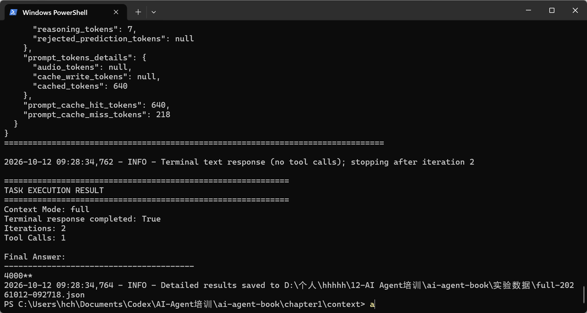

# ai-agent-book 共学笔记

AI Agent 学习笔记与真实实验记录。教材来源：[bojieli/ai-agent-book](https://github.com/bojieli/ai-agent-book)。

本仓库是 Obsidian 中本课程笔记的发布副本，更新至 2026 年 10 月 20 日。图片与内部链接已转换为 GitHub 可以阅读的 Markdown 格式。

## 笔记入口

- [Task1 本次打卡材料与学习小结](<notes/06-Task1-学习小结与打卡材料.md>)
- [Task2 学习小结与补卡材料](<notes/08-Task2-学习小结与补卡材料.md>)
- [Task2 用户记忆与 RAG 学习笔记](<notes/07-Task2-用户记忆与RAG-学习笔记.md>)
- [Task3 工具与 MCP 学习笔记](<notes/09-Task3-工具与MCP-学习笔记.md>)
- [Task3 工具与 MCP 实验计划](<notes/10-Task3-工具与MCP-实验计划.md>)

- [第一章：我的学习笔记](<notes/01-第一章-我的学习笔记.md>)
- [实验 1-1：五组上下文消融结果与复盘](<notes/02-实验1-1-我的实验记录.md>)
- [Task1：上下文工程学习笔记](<notes/03-Task1-上下文工程-学习笔记.md>)
- [Task1：实验记录](<notes/04-Task1-上下文工程-实验记录.md>)
- [10月14日：工具注册、函数与模型、上下文核心概念](<notes/05-20261014-工具注册与上下文补充.md>)
- [Context 工具接入代码与验证方法](experiments/context/README.md)
- [第一章教材](https://github.com/bojieli/ai-agent-book/blob/main/book/chapter1.md)
- [第一章项目目录与推荐阅读顺序](https://github.com/bojieli/ai-agent-book/blob/main/chapter1/README.md)

## 已核对的学习进度

| 内容 | 状态与证据 |
| --- | --- |
| Agent、Model、Harness、上下文与工具的关系 | 已学习，见第一章笔记 |
| Python 独立环境与 DeepSeek API 配置 | 已准备，密钥仅保存在本地 |
| 原项目离线搜索演示 | 已观察，演示结果是预先编写的，见笔记截图 |
| 完整上下文下的单独计算例子 | 已实际运行，结果 4000，2 轮模型请求、1 次工具调用；见下方运行截图，这不是完整消融对照 |
| DeepSeek 独立搜索接口验证 | 已取得真实结果，见下方 JSON；未接入原版 WebSearchAgent |
| 原版 Kimi/Moonshot 真实搜索 | 尚未运行 |
| 实验 1-1 上下文消融对照 | 五组真实 API 运行和复盘已完成；full、no_reasoning 完成营收任务，其余三组未完成，见笔记及原始证据 |
| API 上下文、消息角色、工具调用与结果回传 | 已结合换汇记录学习 |
| Context 自定义营收汇总工具 | 已接入函数、说明和执行映射；本地测试通过；新增工具的真实模型调用待验证 |
| 第二章上下文压缩实验 | 无压缩与按任务摘要两组已执行并复盘；均在 5 轮内未产出最终答案，保留原始 JSON |
| KV Cache | 已学习原理、读取作者历史结果；个人 API 实测待完成 |
| Task2 BM25 稀疏检索 | 已亲自运行三组实验并保存 JSON；观察了精确查询、同义词漏召回和检索指标 |
| Task2 混合检索与用户记忆 | 已学习项目结构和核心原理；尚未由本人运行，不记录实验结果 |
| Task3 Tools 与 MCP | 已完成理论与 execution-tools 代码入口整理；本人运行证据待补，不记录代运行结果 |

单独计算例子的原始 JSON 后来被另一道普通问答覆盖，因此这里不把它当作现存计算轨迹证据。该覆盖问题与每次运行使用独立文件名的经验一并保留。

## Task 0 环境运行截图

原 Context 项目使用 DeepSeek 完成 `(125 + 375) * 8` 的计算任务，终端记录 2 轮模型请求、1 次工具调用，最终答案为 4000。

独立 DeepSeek 搜索适配脚本的实际运行结果，作为 API 与联网搜索验证的补充；它不是原版 Kimi 搜索项目的运行结果。

## 搜索接入验证

实验脚本：[deepseek_search_adapter.py](experiments/web-search-agent/deepseek_search_adapter.py)。这是本人实验时使用的独立 DeepSeek 搜索适配器的原始源码副本，未改动代码，也未接入原版 WebSearchAgent。脚本在原课程目录中读取相邻 `context/.env` 的本地密钥；本笔记仓库不包含该环境文件、API 密钥或虚拟环境。

任务：搜索 DeepSeek 官方目前支持哪些模型，并提供官方来源链接。

- [上限为 3 时的原始记录](evidence/deepseek-search-20261012-101755.json)：前三次返回搜索结果，第四次请求返回 max_uses_exceeded。模型文字已经返回，但适配脚本检查工具错误后停止展示。
- [上限为 5 时的原始记录](evidence/deepseek-search-20261012-103546.json)：实际进行了 4 次搜索，4 个结果块、40 条结果、37 个不同 URL，没有工具错误。

这些记录证明搜索工具返回了结果，不自动证明最终答案中的每一句都正确。已对照官方文档核查主要模型信息；仍需区分搜索摘要、网页原文与模型归纳。

## 本阶段学习心得

通过第一章五组上下文对照，我看到同一个模型能否推进任务，与历史记录、工具说明和工具结果是否被送入下一轮请求有关。完整上下文和不保留历史推理的两组均完成了计算；没有历史的组反复换汇，隐藏工具结果的组无法据此完成汇总。我还在 Context 项目中接入营收汇总函数，理解了模型提出工具名称和参数、Harness 执行 Python 函数并回传结果的分工。本地函数检查已通过，新工具的真实模型调用仍待验证。

## 共学 Task 0 要求与当前进度

依据本人于 2026 年 10 月 12 日提供的班级通知，Task 0 为“Agent 基础与环境准备”，北京时间 10 月 12 日 24:00 截止（即 10 月 13 日 00:00）。

- 学习 Chapter 1，理解 AI Agent 及 `Agent = LLM + Context + Tools`：已学习核心概念，见第一章笔记。
- 配置 Python、依赖和 LLM API：已配置并实际运行。
- 跑通 Chapter 1 基础实验：已跑通原 Context 项目的单次工具调用，并于 10 月 14 日完成实验 1-1 的五组对照；不据此声明全部第一章实验完成。
- 打卡材料为环境运行截图与 100 字以上 Agent 理解/学习笔记：见本页截图和学习心得。
- 扩展项为分析一个熟悉 Agent 产品的 LLM、Context、Tools：尚未单独整理。

本仓库记录实际学习过程；打卡是否通过以课程组织方审核为准。

## Task1 要求与当前边界

根据已提供的班级通知，Task1 学习第二章上下文工程，学习时间为 10 月 12 日至 14 日，截止北京时间 10 月 15 日 03:00。要求理解上下文工程、Prompt 与 Context、Token 与上下文窗口、上下文选择与管理、长上下文与压缩，并至少跑通 1 个相关实验。通知截图没有指定本地部署，也没有要求完成第二章全部实验。第二章上下文压缩两组已经运行并保存结果，但调研任务尚未完成；KV Cache 当前仅查看作者历史数据。最新材料见上方 Task1 学习小结，打卡由本人提交。

## 本次新增证据与代码

- [第二章上下文压缩两组原始结果](evidence/Task1/context-compression-20261014-214135/experiment_20261014_214135.json)
- [KV Cache 作者历史结果的离线对比报告](evidence/Task1/kv-cache-historical-20261014/report.txt)

- [两组对照原始证据](evidence/context-1-1-20261014-094757/evidence.json)
- [五组对照原始证据](evidence/context-1-1-five-20261014-110403-204/evidence.json) 与 [SHA-256](evidence/context-1-1-five-20261014-110403-204/evidence.sha256)
- [自定义工具本地验证](evidence/tool-registration-local-20261014.json)
- [Context 源码](experiments/context/agent.py) 与 [新增工具测试](experiments/context/tests/test_revenue_tool.py)

新增工具发生在五组消融之后：旧证据的工具集含四个工具，当前代码有五个。后续对照需记录这一变化，不能将两种代码状态的结果混为一组。

## 来源与记录说明

- 原教材与代码由上游项目提供，笔记中的教材截图用于记录学习内容；上游许可见 [ai-agent-book LICENSE](licenses/ai-agent-book-LICENSE)。
- 两组与五组 `evidence.json` 为脱敏公开副本：只把命令中的 Python 可执行文件和本地输出目录替换为占位符，模型请求、响应与分析结果未改；配套 SHA-256 对应当前公开副本。搜索记录保留原始字节。本地验证 JSON 单独标明未调用模型 API。
- `experiments/context` 与根目录 `agentbook` 是课程源码及运行依赖模块的副本；自定义变更与验证边界见该目录 README。上游许可保留在 `licenses`。
- 实验 1-1 的汇率工具使用固定测试汇率，用于上下文实验。
- Obsidian 原笔记保留；本发布副本对已有进度描述作了核对，未完成事项明确标为待完成。
