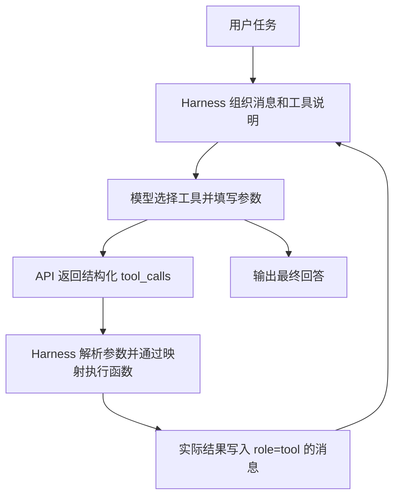

# Task 1：上下文工程学习笔记

## 课程安排与学习状态

| 项目 | 内容 |
|---|---|
| 学习章节 | Chapter 2：上下文工程（Context Engineering） |
| 班级学习时间 | 2026 年 10 月 12 日至 14 日 |
| 班级截止时间 | 北京时间 2026 年 10 月 15 日 03:00 |
| 本次开始记录 | 2026 年 10 月 14 日 |
| 当前进度 | 上下文压缩两组已运行并复盘，均未产出最终答案；继续学习中 |
| 打卡状态 | 待本人提交并确认 |

时间依据是本聊天中提供的班级课程表和 Task 1 公告截图。公告要求学习上下文工程基本概念、Prompt 与 Context 的区别、上下文窗口与 Token 限制、上下文的选择组织管理、长上下文与压缩，并至少跑通 1 个相关实验。该截图没有规定必须完成全部第二章实验，也未给出字数或截图数量要求。本轮压缩对照已有运行记录，但尚未完成调研任务。

前置学习已核验：实验 1-1 的五组消融已实际运行并复盘，见 [02-实验1-1-我的实验记录](<02-实验1-1-我的实验记录.md>)。该实验属于第一章，本篇单独记录第二章的学习。

第二章实际操作单独记录在 [04-Task1-上下文工程-实验记录](<04-Task1-上下文工程-实验记录.md>)。

## 教材与项目入口

- [第二章教材正文](https://github.com/bojieli/ai-agent-book/blob/main/book/chapter2.md)。
- [第二章配套项目说明](https://github.com/bojieli/ai-agent-book/blob/main/chapter2/README.md)。
- [各实验验收与证据说明](https://github.com/bojieli/ai-agent-book/blob/main/chapter2/EXPERIMENT_LEDGER.md)。
- [当前本地版本对应的第二章正文](https://github.com/bojieli/ai-agent-book/blob/dbc046eb896ac4e39aa19c7774c8bf49583b89a6/book/chapter2.md)。

本篇是学习提纲、解释和个人记录，不是教材全文。整理时核对了本地课程版本 `dbc046eb896ac4e39aa19c7774c8bf49583b89a6`，并查看了 GitHub 在线章节和项目索引。

本地代码目录：

```text
chapter2
```

## 这章要解决的问题

第一章的实验已经表明：同样的模型和任务，只改变模型收到的信息，就可能出现正确计算、重复操作或无法回答。

第二章进一步研究：如何选择、组织、更新和压缩这些信息，让模型在当前这一步有足够依据，同时控制输入长度和计算成本。这不需要修改模型权重。

阅读时围绕三个问题做笔记：

1. 模型这一轮具体看到了什么？
2. 哪些信息必须保留，哪些可以稍后加载或压缩？
3. 上下文变化后，任务结果、工具调用和输入成本有什么实际变化？

## 第一步：读懂模型请求的上下文结构

| 信息 | 在本课程 API 示例中的位置 | 换汇实验中的例子 |
|---|---|---|
| 系统规则 | `messages` 中的 `system` 消息 | 使用工具解决任务，完成后回答 |
| 用户任务 | `messages` 中的 `user` 消息 | 四个季度营收及计算要求 |
| 模型回复或工具请求 | `messages` 中的 `assistant` 消息 | 请求将欧元换成美元 |
| 工具执行结果 | `messages` 中的 `tool` 消息 | 返回换算后的美元金额 |
| 工具定义 | 请求独立的 `tools` 字段 | 工具名称、功能、参数格式 |

这是“消息角色”和“工具定义”的位置区别；工具定义不是第五种消息角色。参见教材的[消息角色与工具调用部分](https://github.com/bojieli/ai-agent-book/blob/main/book/chapter2.md#消息的四种角色)。

下面是我用于理解的简化结构示意，不是可直接运行的完整请求：

```text
请求模型：
  messages = [系统规则, 用户任务, 之前的模型回复, 工具结果……]
  tools    = [可用工具的说明……]

模型响应：
  工具调用请求 → Harness 执行 → 结果加入历史 → 下一轮请求
  终止回复     → 结束当前循环
```

模型 API 不会因为上一次收到过数据，就自动获得本次未提供的任务历史。Harness 需要在每次请求中组织足够的上下文。缓存复用计算，也不等于自动补回被删除的信息。

### 与实验 1-1 的连接

- `no_history`：上一轮行动和结果不再发送，所以模型反复重新换汇。
- `no_tool_results`：调用记录仍在，但结果被置空，所以模型缺少继续汇总的依据。
- `no_reasoning`：不保留历史推理，但保留工具结果；本次仍然正确计算。

这些是第一章已核验的观察。第二章的结果要通过新的运行证据单独记录。

### 回顾换汇记录：final_answer 的来源

下面的截图来自第一章五组实验的 `full` 组，用于第二章学习 API 回复与实验记录字段的区别，不代表第二章实验已经运行。


`final_answer` 是课程程序定义的结果字段。字段名称由开发者指定，内容来自模型的终止回复。

这次实际数据的来源是：模型第 3 轮返回 `assistant` 消息 → 读取 `response.choices[0].message.content` → 去掉开头的 `FINAL ANSWER:` 标记 → 保存到本组的 `final_answer` 字段。得到的内容包括换汇表、全年总额 9,602,895.73 美元和季度平均 2,400,723.93 美元。

如果回复没有该标记，程序可以直接保存整段终止文本。因此 `FINAL ANSWER:` 是本项目约定的文字标记，`final_answer` 是记录字段，`assistant` 才是消息的角色。该字段用于记录模型最后给了什么回复，正确性仍需结合任务要求与执行证据判断。

### 请求参数和工具说明是谁提供的

下面的截图仍然来自第一章换汇实验的请求记录，用于学习 API 结构，不代表第二章实验已运行。


字段格式由接口规范约定；数值、工具名称、描述和参数规则由开发者配置，Harness 按配置组织请求。模型读取这些信息后，再输出自己选择的工具名称和实际调用参数。

| 截图字段 | 谁提供具体内容 | 是否必须及含义 |
|---|---|---|
| `temperature: 0.3` | 课程程序设置 | 可选采样参数，是否生效看模型模式 |
| `max_tokens: 8192` | 课程程序设置 | 可选；限制单次生成的 token 数，不是上下文窗口总大小 |
| `tools` | 程序返回已注册的工具定义 | 可选；普通聊天可以不提供，本项目通过它提供正式工具调用接口 |
| `type: function` | 程序按接口格式填写 | 提供函数工具时需声明类型 |
| `name: parse_pdf` | 开发者命名并映射到实际函数 | 提供该函数工具时，名称必填 |
| `description` | 开发者编写 | 可选功能描述，帮助模型选择工具 |
| `parameters` | 开发者编写参数 schema | 描述参数结构；这里声明 `url` 为字符串 |
| `required: [url]` | 开发者声明工具的参数要求 | 表示调用 `parse_pdf` 时需要传 `url`，不是每次模型请求都要提供 URL |

源码对应 `chapter1/context/agent.py` 的 `_get_tools_description()` 和 `execute_task()`。这个实验发送完整的四工具清单，因此请求里会有 `parse_pdf`，即使本次任务实际只调用换汇和汇总工具。

已核对的服务规则：DeepSeek 当前文档将 `temperature`、`max_tokens` 和 `tools` 列为可选字段，并说明思考模式下 `temperature` 不生效。此次记录同时开启 `thinking: enabled`，不能仅凭 `temperature: 0.3` 推断它实际控制了生成随机性。参见 [DeepSeek Chat Completions 参数说明](https://api-docs.deepseek.com/zh-cn/api/create-chat-completion/)。

### 学习 API 上下文结构的具体目标

要学会读懂和组织一次完整交互：任务和规则怎样进入请求；工具说明怎样提供；模型在哪里返回调用请求；Harness 如何执行并回传结果；下一轮如何继续包含必要历史。参见教材的 [API 上下文结构部分](https://github.com/bojieli/ai-agent-book/blob/main/book/chapter2.md#agent-如何调用大模型理解-api-的上下文结构)。

结合换汇实验，能够指出下面这些位置：

```text
换汇任务          → messages 中的 user 消息
可用换汇工具说明  → 请求的 tools 字段
模型选择及参数    → assistant 回复中的 tool_calls
函数执行结果      → Harness 放入的 tool 消息
继续计算          → 下一轮重新组织 messages 并请求模型
```

不同服务商、接口和模型可能有格式或参数支持差异，需要查相应文档；部分接口也能兼容同一种格式。当前先读懂一套真实交互，再检查更换接口时需要适配哪些地方。这也是后面研究缓存和压缩之前需要掌握的基础。

### 模型第一轮返回的 tool_calls

原始来源：[第一章五组换汇证据](<../evidence/context-1-1-five-20261014-110403-204/evidence.json>)中的 `full` 组。查看第一条 `api_turns` 的 `response.choices[0].message.tool_calls`，可以看到模型的调用请求。

请求中的 `tools` 是开发者提供的可用工具说明；响应中的 `tool_calls` 是模型根据任务选择的本次调用。即使模型请求调用工具，这条模型消息的角色仍然是 `assistant`。

本次第一轮模型回复还包含文字：“I'll convert each non-USD quarter to USD using the currency tool.” 随后在同一响应中提出三次 `convert_currency` 调用：

| 调用 | amount | from_currency | to_currency |
|---|---:|---|---|
| 第一次 | 2100000 | EUR | USD |
| 第二次 | 1800000 | GBP | USD |
| 第三次 | 380000000 | JPY | USD |

一轮模型响应可以包含多个调用请求；这不等于工具已经执行，也不等于 Harness 一定并行执行。

每条调用包含 `id`、`type` 和 `function`。其中 `function.name` 指定要调用的函数，`function.arguments` 给出这次的具体参数。在本次 API 响应中，`arguments` 是 JSON 字符串，Harness 用 `json.loads()` 将它解析为参数字典，再调用预先编写的 Python 函数。

第一条调用的编号为 `call_00_v2XGHyu6GznYQNwY2f6f3252`，实际执行相当于 `convert_currency(2100000, "EUR", "USD")`。工具返回 `converted_amount=2282608.7`。Harness 将结果作为 `role: tool` 消息放回历史，并把该消息的 `tool_call_id` 设置为同一个编号，表明这是第一条调用的反馈。

这次第二轮请求的消息顺序为：`system → user → assistant → tool → tool → tool`。其中 `assistant` 记录三次调用请求，三条 `tool` 分别记录对应的执行结果。模型在第二轮收到这些数据后，才能继续汇总。

同一证据文件还有另一处同名 `tool_calls`：每组结果顶层的列表是程序整理的实际执行记录，含 `tool_name`、`arguments` 和 `result`。阅读时要区分原始 API 调用请求和本地执行记录。

### 流式输出与思考字段

本节是概念讲解与分片示意，尚未执行流式实验。已核对的第一章换汇代码没有启用 `stream`；其 `full` 组三轮返回的对象都是 `chat.completion`，每轮同时保存完整消息中的 `reasoning_content`、`content` 和 `tool_calls`（具体是否有调用随轮次而变）。

| 接收方式 | 客户端怎样获得一次模型回复 |
|---|---|
| 非流式 | 等该轮生成结束后，接收完整消息 |
| 流式 | 在该轮生成过程中，逐块接收增量并累积完整回复 |

DeepSeek Chat Completions 通过 `stream: true` 开启流式；完整回复通常读取 `choices[0].message`，流式增量读取 `choices[0].delta`。增量可能包含推理文本、回答文本或工具调用片段，不一定每块恰好对应一个字或一个 token。参见 [DeepSeek 流式响应说明](https://api-docs.deepseek.com/zh-cn/api/create-chat-completion/)。

用换汇参数做分片示意，下面不是已收到的真实网络分片：

```text
参数片段 1：{"amount":
参数片段 2：2100000,"from_currency":
参数片段 3："EUR","to_currency":"USD"}

拼接后：{"amount":2100000,"from_currency":"EUR","to_currency":"USD"}
```

Harness 需要按调用编号／索引归并参数片段，确认调用完整、参数有效后，再执行函数。只看到工具名称或一半参数时，不足以执行这次换汇。

| 信息 | 本次 DeepSeek API 的字段／来源 |
|---|---|
| 推理文本 | `reasoning_content`，流式时可出现在 `delta` 中 |
| 回复文字 | `content`，流式时可逐段累积 |
| 工具调用请求 | `tool_calls`，工具参数可能分片返回 |
| 工具执行结果 | Harness 执行后产生，再通过 `role: tool` 消息回传 |

思考模式与流式是两个维度：非流式也可以包含推理文本，流式也可以传送普通回答。不能用“有没有思考文字”判断“是不是流式”。

教材这个本地项目的 Qwen3/Ollama 示例还展示了另一种呈现：原始生成文本中的 `<think>` 标签可由服务端解析成独立的 `thinking` 字段。我们 DeepSeek 记录里的字段叫 `reasoning_content`。这些不是新的消息角色，具体表现应看模型和服务端协议。参见 [本地模型项目的思考字段说明](https://github.com/bojieli/ai-agent-book/blob/main/chapter2/local_llm_serving/README.md)。

README 示例中 `thinking`、`tool_call`、`tool_result`、`content` 这几种 `type`，是客户端 Agent 为展示过程整理的事件类型，不能直接当成 DeepSeek API 的 `role`。工具执行结果来自 Harness 的工具执行过程。

流式主要改变接收和展示方式，不自动保证总生成耗时更短或 token 费用更低。当前学习状态：已讲解这一机制，流式实测及本地实验 2-1 仍待完成。

### 自定义工具注册：季度营收汇总（离线教学）

本次复用第二章 `local_llm_serving/tools.py` 中的 `ToolRegistry`，在课程 Python 环境中完成了离线注册、说明导出和手工参数执行。没有调用模型服务，也没有修改课程源码。具体检查结果见 [工具注册离线教学记录](<04-Task1-上下文工程-实验记录.md#辅助教学练习自定义工具注册>)。

注册要同时准备两部分：本地能执行的 Python 函数，以及模型能读懂的名称、功能和参数说明。`register_tool()` 是课程封装的方法，不是向模型厂商上传 Python 文件的 API。

#### 第一步：写一个能独立执行的函数

这个教学工具只接收四个已换算为美元的非负金额，计算全年总额和季度平均值。

```python
import math

def summarize_revenue(q1_usd: float, q2_usd: float,
                      q3_usd: float, q4_usd: float) -> dict:
    amounts = (q1_usd, q2_usd, q3_usd, q4_usd)
    if any(type(value) not in (int, float)
           or not math.isfinite(value) or value < 0
           for value in amounts):
        raise ValueError("季度金额必须是非负、有限的数值，且全部已换算为美元")
    total = sum(amounts)
    if not math.isfinite(total):
        raise ValueError("汇总金额超出范围")
    return {
        "annual_total_usd": round(total, 2),
        "quarter_average_usd": round(total / 4, 2)
    }
```

函数本身负责计算与输入检查。它暂时只是 Python 函数；模型还没有收到它的说明。

#### 第二步：注册名称、函数对象和说明

下面的导入假设代码在课程的 `chapter2/local_llm_serving` 目录中执行。这个注册器与第一章固定的工具说明／执行映射不是同一套接入代码。

```python
from tools import ToolRegistry

registry = ToolRegistry()
registry.register_tool(
    name="summarize_revenue",
    function=summarize_revenue,
    description="汇总四个已换算为美元的非负季度营收，返回全年总额和季度平均值。本工具不负责换汇。",
    parameters={
        "type": "object",
        "properties": {
            "q1_usd": {"type": "number", "minimum": 0, "description": "第一季度美元营收"},
            "q2_usd": {"type": "number", "minimum": 0, "description": "第二季度美元营收"},
            "q3_usd": {"type": "number", "minimum": 0, "description": "第三季度美元营收"},
            "q4_usd": {"type": "number", "minimum": 0, "description": "第四季度美元营收"}
        },
        "required": ["q1_usd", "q2_usd", "q3_usd", "q4_usd"],
        "additionalProperties": False
    }
)
```

| 注册项 | 用途 | 是否进入模型的工具说明 |
|---|---|---|
| `name` | 给调用接口命名 | 是 |
| `function` | 保存真正可执行的 Python 函数对象 | 否 |
| `description` | 描述用途、适用条件和边界 | 是 |
| `parameters` | 描述输入字段、类型和必填项 | 是 |

`function=summarize_revenue` 不带括号，表示保存函数对象，等待调用。示例中接口名与函数名相同，便于理解；注册表实际保存的是“接口名 → 函数对象”的对应关系。当前课程注册器会覆盖同名条目，添加时应避免名称冲突。

#### 第三步：导出说明，再加入模型请求

```python
tool_schemas = registry.get_tool_schemas()
```

这一步产生可以序列化成 JSON 的工具清单，没有包含 Python 函数对象。调用模型时，将清单传给请求的 `tools` 字段。仅调用 `register_tool()` 完成本地登记，还没有向模型发送任何信息。

实际接入本地项目时，应复用 Agent 正在使用的注册表。课程入口对象若命名为 `app`，其后端注册表在 `app.agent.tool_registry`。单独创建另一个 `ToolRegistry()`，不会自动修改已有 Agent 的清单。本次离线练习使用独立注册器，没有初始化模型后端。

#### 第四步：按名称和参数执行

本次用第一章已经换算好的美元金额，手工提供参数，验证本地执行：

```python
result = registry.execute_tool("summarize_revenue", {
    "q1_usd": 2500000,
    "q2_usd": 2282608.70,
    "q3_usd": 2278481.01,
    "q4_usd": 2541806.02
})
print(result)
```

实际输出的目标金额：全年总额 `9602895.73`，季度平均 `2400723.93`。该课程方法将字典结果序列化为 JSON 字符串。

接上模型后，工具名和参数应来自模型返回的 `tool_calls`，由 Harness 解析并执行，再通过带对应 `tool_call_id` 的 `tool` 消息回传。本次尚未测试模型选择、参数生成和完整模型循环。

源码中的核心关系是：`register_tool()` 保存函数和说明；`get_tool_schemas()` 导出名称、描述及参数格式；`execute_tool()` 根据名称取出本地函数，再用 `**arguments` 按参数名调用。JSON Schema 是输入约定，实际参数仍需检查，本教学函数已做数值检查。

## 第二步：认识本章的几种上下文管理方法

| 概念 | 先理解到什么程度 |
|---|---|
| KV Cache 与前缀缓存 | 复用已有的模型计算；前缀是否一致、服务是否支持复用都会影响命中 |
| 提示工程 | 将目标、规则、工具说明组织得明确，减少歧义 |
| Agent Skills | 按需要加载领域规则和示例，避免一开始塞入全部内容 |
| 状态栏或状态提示 | 显式提供当前进度、限制和待办，减少反复从长历史中推导状态 |
| 上下文压缩 | 缩短旧信息，同时保留继续决策所需的事实、约束和来源 |
| 提示注入防护 | 外部文档和工具返回内容可能含指令，需要区分资料与有效任务要求 |

上述主题来自[第二章正文](https://github.com/bojieli/ai-agent-book/blob/main/book/chapter2.md)，详细机制和边界随阅读补充。

用营收任务理解“压缩”：至少保留三个已换汇金额、它们的来源、计算限制和下一步待办。只留下“已经做过换汇”这句话，后续模型仍然无法准确求和。这是学习示例，尚未运行压缩实验。

理解缓存时，还要分清：输入更短不一定缓存命中更多；保留完整历史也不保证缓存必然命中。应记录实际输入和服务返回的缓存指标，延迟只作为辅助观察。

## 第二章实验目录地图

| 实验编号 | 项目或位置 | 主要观察内容 |
|---|---|---|
| 2-1 | `local_llm_serving` | 本地模型服务与工具调用 |
| 2-2、2-8 | `attention_visualization` | 注意力可视化及状态提示的影响 |
| 2-3 | `kv-cache` | 上下文组织与缓存复用 |
| 2-4 | `prompt-engineering` | 提示词组织方式的对照 |
| 2-5 | `prompt-injection` | 注入攻击与防御配置 |
| 2-6 | `agent-skills-ppt` | 使用 Skill 从论文生成演示文稿 |
| 2-7 | 教材正文练习 | 根据个人范文制作写作 Skill |
| 2-9 | `system-hint` | 状态提示技术 |
| 2-10 | `context-compression` | 上下文压缩策略对照 |

编号与目录对应关系依据[官方项目索引](https://github.com/bojieli/ai-agent-book/blob/main/chapter2/README.md#配套项目)。是否全部必做，以班级 Task 1 公告为准。

## 接下来怎么学

下面是本次学习建议，具体运行命令在选定实验、核对配置后再填写。

1. 先读教材“Agent 如何调用大模型：理解 API 的上下文结构”，用换汇实验确认四种消息角色与 `tools` 字段的位置。
2. 再读“KV Cache 友好的上下文设计”，理解稳定前缀与动态历史的区别。
3. 选择第二章实验。官方首次阅读路线是模型服务接口 → 缓存 → 历史压缩；Starter 路线也提供压缩项目的单策略 smoke。结合现有 DeepSeek API，先核验项目支持和依赖，再决定实际运行哪条路径。
4. 保存实际请求、工具轨迹、输出和截图，再写结果解释；官方示例的预期效果单独注明。
5. 整理本章理解和已执行实验，将可访问的笔记链接用于本人打卡。

路线来源：[第二章 README](https://github.com/bojieli/ai-agent-book/blob/main/chapter2/README.md#第一次阅读的顺序)。

已核对的配置边界：`kv-cache` 的当前本地 README 默认使用 Kimi；第一章 DeepSeek 已跑通，并不代表第二章所有项目已完成适配。第二章的实际运行路径目前待核验。

### 学习进度

- [x] 建立独立 Task 1 笔记，链接第一章真实实验记录。
- [x] 阅读并解释 API 上下文结构（结合第一章换汇记录）。
- [x] 学习稳定前缀、KV Cache 与跨请求缓存的基本概念；当前查看的是作者历史结果。
- [ ] 阅读提示工程、Skills、状态提示和压缩部分。
- [ ] 核对所选实验的模型支持、输入和环境。
- [x] 执行第二章上下文压缩对照并保存真实证据（两组均未产出最终答案，任务未完成）。
- [ ] 复盘结果，完成本人打卡。

## 实验记录区

2026-10-14 已运行实验 2-10 的无压缩与按任务摘要两组，完整分析见 [04-Task1-上下文工程-实验记录](<04-Task1-上下文工程-实验记录.md#实验一2-10-上下文压缩策略对比>)。

| 检查项 | 无压缩 | 按任务摘要 |
|---|---|---|
| 模型交互轮数／工具调用总次数 | 5／17 | 5／8 |
| 主 Agent token | 54,626 | 30,287 |
| 总耗时 | 16.28 秒 | 33.79 秒 |
| 统计的正文长度 → 处理后长度 | 7,417 → 10,192 字符 | 4,625 → 387 字符 |
| 上下文溢出记录 | 0 | 0 |
| 最终答案／任务完成 | 无／未完成 | 无／未完成 |

本次观察：摘要组统计内容更短、主 Agent token 更少，但耗时更长；两组都到达 5 轮上限而没有最终回答。token 指标不含生成摘要的额外调用；两组搜索材料也不完全相同，不能直接得出总费用降低或质量更好的结论。无压缩长度变大的原因是统计时加入了标题、链接等字段，且其统计文本与实际发送的 JSON 格式不一致。

原始 JSON 已保存在 `实验数据/Task1/context-compression-20261014-214135/`，并核对副本 SHA-256。本轮未提供新截图；已有截图保持原样。

## 我的理解与疑问

### 用自己的话解释

上下文工程为什么影响工具选择和任务完成：待学习后填写。

稳定前缀与保留关键历史为什么需要同时考虑：待学习后填写。

压缩之后，如何判断必要信息有没有丢失：待实验后填写。

### 尚未解决的问题

- 已收到的 Task 1 公告要求至少跑通 1 个相关实验；本轮已有对照数据，但调研任务尚未产出最终答案，不能记为任务完成。
- 上下文压缩项目已按 DeepSeek 配置运行；当前记录有汇总用量与耗时，但缺少逐轮原文、摘要和摘要调用的 token，后续验证需补齐这些证据。
- 我之前想尝试“只保留最近两轮历史”，与保留关键事实的压缩方式有什么差异？作为后续对照问题，尚未实现或运行。

## 打卡入口

[课程打卡表](https://magicyang.feishu.cn/share/base/form/shrcnCXBWW7pd3HG4yHUjwaGYYx)。本篇当前是学习中的记录，提交内容应与实际完成情况一致。


##### 主题1：阅读并解释 API 上下文结构

本地部署大模型不是不是本次学习的目的，因此不部署，利用之前的项目来看API上下文结构，每个大模型官方api不一样，所以规则和结构不一样
[FIM Completion API (Beta) | DeepSeek API Docs](https://api-docs.deepseek.com/api/create-completion/)
deepseek有自己的文本补全接口


##### 主题2：怎样把一个自己写的 Python 函数注册成模型可调用的工具

项目：`chapter1/context`。

核心文件：`agent.py`。本篇以实际接入的 `summarize_revenue` 为例，说明第一章 Context 项目的注册方式。前面的第二章离线教学使用了 `register_tool()`；当前项目通过“函数实现 + 工具说明 + 执行映射”接入，不需要照搬那套注册器。

**目标：让模型可以请求一个自己写的 Python 函数，由 Harness 执行，并把真实结果送入下一轮上下文。**

###### 先分清函数、工具和模型

- `def` 定义 Python 函数。它可以进行确定性计算、读文件或请求外部服务；有专门用途不等于它是一个小模型。
- AI 模型包含学习得到的参数。函数可以调用模型，但函数自身不因此自动成为模型。
- `@staticmethod` 是类中的静态方法标记，表示调用不需要传入实例参数 `self`。
- 函数的 `"""文档字符串"""` 说明用途、输入和输出，主要供读代码的人使用。当前项目不会自动将它发送给模型。
- 模型可见的说明位于 `_get_tools_description()` 中；函数实现、工具说明和本地执行映射要对应。

###### 注册工具的三个位置

**1. 实现 Python 函数**

以下来自本次保存的源码。四个金额必须已经换算为美元，函数不负责获取汇率。

```python
@staticmethod
def summarize_revenue(q1_usd: float, q2_usd: float,
                      q3_usd: float, q4_usd: float) -> Dict[str, Any]:
    """Summarize quarterly revenue already converted to USD."""
    amounts = (q1_usd, q2_usd, q3_usd, q4_usd)
    for value in amounts:
        if type(value) not in (int, float) or not math.isfinite(value) or value < 0:
            raise ValueError("季度营收必须是非负、有限的数值")
    total = sum(amounts)
    if not math.isfinite(total):
        raise ValueError("汇总金额超出范围")
    return {
        "annual_total_usd": round(total, 2),
        "quarter_average_usd": round(total / 4, 2),
    }
```

**2. 提供模型可见的说明**

在 `ContextAwareAgent._get_tools_description()` 返回的工具列表中增加以下条目；其余工具保留：

```python
{
    "type": "function",
    "function": {
        "name": "summarize_revenue",
        "description": "汇总四个已换算为美元的季度营收，计算全年总额和季度平均值。本工具不负责换汇。",
        "parameters": {
            "type": "object",
            "properties": {
                f"q{quarter}_usd": {
                    "type": "number",
                    "minimum": 0,
                    "description": f"第{quarter}季度美元营收",
                }
                for quarter in range(1, 5)
            },
            "required": [f"q{quarter}_usd" for quarter in range(1, 5)],
            "additionalProperties": False,
        },
    },
}
```

`required` 表示选择这个工具时必须提供的参数，不表示每次都必须选择这个工具。Schema 是接口说明，不能替代本地参数校验。

**3. 建立执行映射**

在 `_execute_tool()` 的 `tool_map` 中加入：

```python
"summarize_revenue": self.tools.summarize_revenue,
```

现有代码按名称取出函数，并把参数字典展开成具名参数：

```python
return tool_map[tool_name](**arguments)
```

只有说明没有映射，Harness 无法执行；只有函数没有说明，模型不知道它是一个可调用工具。

###### 完整调用流程



模型看见工具名称、说明、参数结构，不会因为注册而收到整个 Python 函数源码。`tool_call_id` 用来把结果与相应调用关联起来。`full` 模式可验证完整回传，`no_tool_calls` 移除工具定义，`no_tool_results` 隐藏工具结果。

###### 多个 Python 文件如何接入

不同工具可以分别定义在不同文件中，再导入到 Agent 所在模块。示例（仅说明组织方法，本次实际代码仍在 agent.py）：

```python
from revenue_tools import summarize_revenue

# _execute_tool() 的映射中引用导入的函数
# "summarize_revenue": summarize_revenue
```

模型可见的工具说明仍需要加入 `_get_tools_description()`。注册的对象是可调用函数，不是整个文件；一个业务工具内部也可以调用多个文件中的辅助函数。仅在脚本直接运行时执行的代码应放进 `if __name__ == "__main__":`。

###### 模型调用与结果回传的关键代码

下面是项目正常工具调用路径的教学简化。它依赖已有的 Agent、消息列表和请求参数；省略了错误处理与实验轨迹记录，不能作为独立脚本直接运行。

```python
# 把工具说明随任务、历史消息一起发给模型
create_kwargs["tools"] = self._get_tools_description()
create_kwargs["tool_choice"] = "auto"
response = self.client.chat.completions.create(**create_kwargs)
message = response.choices[0].message

if message.tool_calls:
    # 先保存模型的调用请求，再添加与其对应的工具结果
    messages.append(self._prepare_assistant_message(message))
    for tool_call in message.tool_calls:
        tool_name = tool_call.function.name
        arguments = json.loads(tool_call.function.arguments)
        result = self._execute_tool(tool_name, arguments)
        messages.append({
            "role": "tool",
            "tool_call_id": tool_call.id,
            "content": json.dumps(result, ensure_ascii=False),
        })
    # 外层循环会把更新后的消息发送给模型，继续决策。
```

- `tool_choice="auto"`：让模型根据任务决定是否调用工具。
- `tool_call.function.name`：模型请求的工具名称。
- `tool_call.function.arguments`：API 返回的参数 JSON 字符串，需要解析并校验。
- `**arguments`：把参数字典展开成 Python 函数的具名参数。
- `role="tool"`：将执行结果作为工具消息回传。
- `tool_call_id`：让结果与对应的工具调用关联。

例如，工具参数可以是：

```json
{
  "q1_usd": 2500000,
  "q2_usd": 2282608.70,
  "q3_usd": 2278481.01,
  "q4_usd": 2541806.02
}
```

这段是参数示例，不是新增工具已被模型调用的证据。本地执行上述参数已得到：

```json
{
  "annual_total_usd": 9602895.73,
  "quarter_average_usd": 2400723.93
}
```

###### 函数里的描述必须写吗

函数里的三引号文档字符串说明用途、参数和返回值，主要给开发者阅读；删除它不影响函数执行。当前项目不会自动读取它生成模型工具说明。

模型看到的是 `_get_tools_description()` 中的 `name`、`description` 和 `parameters`。应写清工具适用场景、参数含义与单位。两份说明分别维护，不能只写了函数文档就认为已经完成工具注册。

###### 验证时看什么

1. 检查 `_get_tools_description()` 是否包含新工具。
2. 使用已知参数直接执行 `_execute_tool()`，核对计算结果。
3. 检查缺失参数、错误类型和非法金额；Schema 不能代替本地校验。
4. 使用 `full` 模式调用真实模型，查看 `tool_calls` 中是否实际出现 `summarize_revenue`，参数是否正确。
5. 对照工具返回值和最终回答，确认结果被模型利用。

本次已核验：函数、说明和映射已接入；3 个本地测试通过，覆盖注册与执行、非法金额、数值溢出。新增工具的真实模型调用尚未有已核验的轨迹，不能只凭最终金额正确认定工具调用成功。

五组消融实验发生在新增工具之前：旧证据包含四种工具，当前代码包含五种工具，后续复现实验需要记录工具集变化。

###### 一句话记忆

**开发者写函数和工具说明 → Harness 把任务与说明发送给模型 → 模型选择工具并填写参数 → Harness 执行函数 → 把结果送回模型 → 模型继续决策或回答。**

独立 Markdown：[05-Python函数注册为模型工具-操作流程](<05-Python函数注册为模型工具-操作流程.md>)。


##### 主题3：上下文压缩实验

###### 1. 本次结论

两组都已执行并生成结果文件，但都在 5 轮上限内没有产出最终答案。按任务摘要组的统计内容长度和主 Agent token 消耗更低，运行时间更长。现有记录不能证明摘要保留了全部关键事实，也不能证明总费用降低或任务质量提高。

这是一次有实际数据的对照尝试；任务目标尚未完成，不写成“调研成功”。

###### 2. 任务与运行条件

- 项目：`chapter2/context-compression`，入口 `experiment.py`，对应课程实验 2-10。
- 日期：2026-10-14；两组结果记录时间分别为 21:41:56 和 21:42:32。
- 默认任务：`Please research and find the current affiliations of all OpenAI co-founders.`，即调研 OpenAI 所有联合创始人当前的职业归属。
- 策略：`no_compression` 与命令行别名 `context_aware`；后者在 JSON 中记为 `context_aware_summary`。
- 每组模型交互上限：5 轮。一轮回复可以请求多个工具，所以 5 轮不等于最多 5 次工具调用。
- 启动配置：DeepSeek，指定模型名 `deepseek-flash`。这一信息来自运行前的命令和配置检查；本次 JSON 未保存请求模型和服务端返回模型，不能仅凭该文件核验实际模型版本。
- 搜索来源：运行准备时未配置 Serper 搜索密钥，源码在此情况下使用示例搜索数据。本次文件未保存逐次工具来源，不能作为真实现状调研的证据。另一个工具 `fetch_webpage` 可以抓取真实网页，因此也不能笼统说所有工具都没有联网。
- 实验不修改模型权重；改变的是工具结果进入下一轮上下文前的处理方式。

###### 3. 两种策略的流程区别

**无压缩：** 模型请求 `search_web` → 工具返回搜索结果 → Harness 把完整结果序列化为 JSON → 作为 `role: tool` 消息加入历史 → 下一轮模型继续读取。

**按任务摘要：** 模型请求 `search_web` → 工具返回搜索结果 → 压缩器结合当前搜索问题及最近的查询记录，请模型生成相关摘要 → Harness 把摘要作为 `role: tool` 消息加入历史 → 下一轮模型根据摘要继续行动。

本项目的“按任务”具体依据当前搜索查询，并附带最近 3 条工具调用的查询描述；它不是把整段对话都重新总结。该策略主要处理 `search_web` 的结果，不能理解为所有消息和所有工具输出都会被压缩。摘要输入中每页正文最多取 5,000 字符，提示词要求摘要最多 500 token。

理解示例（说明机制，不是本次日志原文）：当前只问“某人的职业归属”，搜索结果却有大段人物背景。无压缩会把背景一起交给模型；按任务摘要会尝试提取姓名、机构、职位、日期等相关信息。

###### 4. 本次实际结果

| 指标 | 无压缩 `no_compression` | 按任务摘要 `context_aware_summary` |
|---|---:|---:|
| 模型交互轮数 | 5 | 5 |
| 工具调用总次数 | 17 | 8 |
| 主 Agent 累计 token | 54,626 | 30,287 |
| 总运行时间 | 16.28 秒 | 33.79 秒 |
| 程序记录的上下文溢出次数 | 0 | 0 |
| 统计的原始正文总长度 | 7,417 字符 | 4,625 字符 |
| 统计的处理后总长度 | 10,192 字符 | 387 字符 |
| `compression_ratio` | 1.374 | 0.084 |
| `success` | `false` | `false` |
| `final_answer` | `null` | `null` |
| `final_answer_length` | 0 | 0 |
| 顶层 `error` | `null` | `null` |

**无压缩组怎么读：** 5 轮中发生了 17 次工具调用，消耗 54,626 个主 Agent token，16.28 秒后结束，没有最终回答。本次没有触发程序的上下文溢出记录，不能套用 README 中“无压缩会溢出”的示例结论。文件没有逐次调用明细，不能判定其中哪些调用重复或没有必要。

**按任务摘要组怎么读：** 同样执行 5 轮，发生 8 次工具调用，主 Agent token 为 30,287，耗时 33.79 秒，也没有最终回答。该策略统计的搜索正文从累计 4,625 字符变为 387 字符，约减少 91.63%；这里是字符数，不是 token，也不是整个对话的长度。

**共同的停止原因：** 结合 `agent.py` 的循环条件、5 轮上限、空最终回答和空顶层错误，可判断本轮达到轮数上限时结束，没有进入产出最终答案的结束分支。没有抛出顶层异常，不等于完成任务。

###### 5. 指标容易误读的地方

1. **主 Agent token 约减少 44.56%，不代表总费用同幅下降。** `total_tokens` 累计主研究模型调用的输入和输出用量；压缩器额外请求模型生成摘要，其用量没有计入该字段。本次 JSON 也没有完整计费信息及分别记录的输入、输出、缓存用量。
2. **摘要组耗时约为无压缩组的 2.08 倍。** 额外的摘要请求可能增加耗时；各组工具路径、请求延迟也可能不同，现有汇总记录不能把时间差全部归因于摘要。
3. **无压缩比例为什么大于 1？** `original_length` 只统计正文；`_no_compression()` 的格式化文本又加入标题、URL、Snippet、分隔符等，因此处理后统计长度增加到 10,192。该长度还不是实际发送给模型的 JSON 长度：真正发送内容使用 `json.dumps(result, indent=2)`。这是统计口径不完全一致，不能据此说“压缩失败”，也不能把该数值当完整请求长度。
4. **两组没有处理完全相同的一批文本。** 累计原始长度分别为 7,417 和 4,625，工具调用次数也不同。初始任务相同，但运行路径不同。这是两种策略下的 Agent 运行对照，不能直接当作相同固定文本上的摘要质量测评。
5. **387 字符不一定全部来自成功的模型摘要。** `_context_aware_summary()` 在摘要调用异常时会改用搜索结果的 Snippet 拼接，结果仍标为同一策略。本次 JSON 未保存是否发生该分支，不能排除这种情况；顶层 `error: null` 也不能排除内部已经处理的异常。
6. **`success` 只是本脚本的结束标志。** 源码以 `final_answer is not None` 判断成功，没有自动核实答案事实、完整性或引用。此次均为 `false`；即便以后为 `true`，仍需要检查答案质量。

###### 6. 原始证据与代码依据

- [本轮原始结果 JSON](../evidence/Task1/context-compression-20261014-214135/experiment_20261014_214135.json)。
- [原始结果 SHA-256 校验文件](../evidence/Task1/context-compression-20261014-214135/experiment_20261014_214135.sha256)。
- SHA-256：`97a2bf018fec69431e82905db847dfd05964726293473b99e5096cc6951a8ccd`。归档副本与项目 `results/` 中的原文件逐字节一致。
- 本次没有收到新的执行截图；现有笔记图片保持原样，本轮截图待补充。

代码依据均位于 `chapter2/context-compression`：

| 文件／位置 | 核对内容 |
|---|---|
| `agent.py`：`execute_research()` | 初始任务、轮数上限、工具结果进入历史、最终回答与成功判断 |
| `agent.py`：模型响应处理 | 主 Agent 的 token 统计 |
| `compression_strategies.py`：`_no_compression()` | 正文与格式化文本长度的统计口径 |
| `compression_strategies.py`：`_context_aware_summary()` | 查询相关摘要、每页截取、额外模型请求及异常时的 Snippet 拼接 |
| `experiment.py`：`run_single_strategy()` | 指标汇总和实际保存字段 |
| `web_tools.py`：`search_web()` | 未配置搜索密钥时使用示例搜索数据 |

本 JSON 只保留汇总指标、最终回答字段和时间戳，没有保存每轮请求、工具参数、原文、摘要和完整响应。因此无法核对模型具体看到了什么、为什么继续调用工具、哪些事实被保留或丢失，以及是否发生摘要异常后的替代处理。

###### 7. 学习心得与后续验证

这次我观察到，上下文压缩发生在工具返回结果之后、下一轮请求模型之前。它会改变模型后续能够看到的材料，不需要改模型参数。摘要组本次统计内容更短、主流程 token 更少，但耗时更长，而且两组都没有完成最终回答。判断一种压缩方法是否合适，应同时检查信息是否保留、任务是否完成、完整 token 消耗和运行时间，不能只看压缩比例。

后续若继续验证，先保留逐轮工具记录、压缩前正文和压缩后摘要，再用同一任务与相同轮数预算比较；若提高轮数上限，应两组一起调整，新结果另存为新一轮记录。评价摘要质量还应使用同一份固定材料，核对姓名、机构、日期和来源等必要事实。上述补充尚未执行，本记录只对应本轮数据。


##### 主题4：KV Cache 缓存对比

KV Cache 缓存对比，就是观察：模型能不能复用之前算过的内容，减少重复计算，让后续请求可能更快、成本更低

###### 本次学习与证据范围

KV Cache 保存模型注意力计算中的中间数据；本实验关注服务端是否能跨请求复用相同前缀。上下文压缩是减少传入内容，缓存复用是尽量复用已经完成的计算；有缓存通常仍需在请求中提供必要上下文。

| 模式 | 实际组织方式 | 使用时的判断 |
|---|---|---|
| `correct` | 保持系统规则、工具顺序和前缀稳定，后续消息追加到末尾 | 规则稳定的多轮任务，可为缓存复用创造条件 |
| `dynamic_system` | 每轮加入时间戳并重建消息，任务消息与历史的相对位置也发生变化 | 教学中用于观察前缀变化；业务确需更新规则时，应以信息正确为先 |

稳定规则和动态信息可以共存。例如换汇规则保持稳定，最新汇率和计算结果由工具返回并追加到后面。不能为了缓存继续使用过期规则，也不能仅因代码创建了一个新消息列表，就认定缓存失效；服务端看到的实际 token 前缀是否变化才是关键。

本次由助手执行 `main.py --report`，读取的是仓库作者保存的两组 Kimi 历史结果，不是本人新发起的 DeepSeek API 实测：

| 历史组别 | 交互轮数 | 输入 token | 缓存 token | 缓存占比 | 总耗时 |
|---|---:|---:|---:|---:|---:|
| 稳定前缀 `correct` | 3 | 7,567 | 768 | 约 10.1% | 18.163 秒 |
| 动态系统提示 `dynamic_system` | 3 | 7,639 | 768 | 约 10.1% | 24.260 秒 |

两组缓存 token 相同，本记录没有展示明显的缓存量差异；一次耗时差异不足以证明某模式必然更优。脚本还改变了消息组织顺序，并非严格只改变时间戳的单变量对照。源码中名为 TTFT 的计时包围了非流式完整请求，不能直接视为严格测量的首 token 延迟。

[本次生成的历史数据离线对比报告](../evidence/Task1/kv-cache-historical-20261014/report.txt)。

本节状态：已学习原理、查看历史报告并核对部分源码；尚未用自己的 DeepSeek API 完成本实验的真实对照测量。
