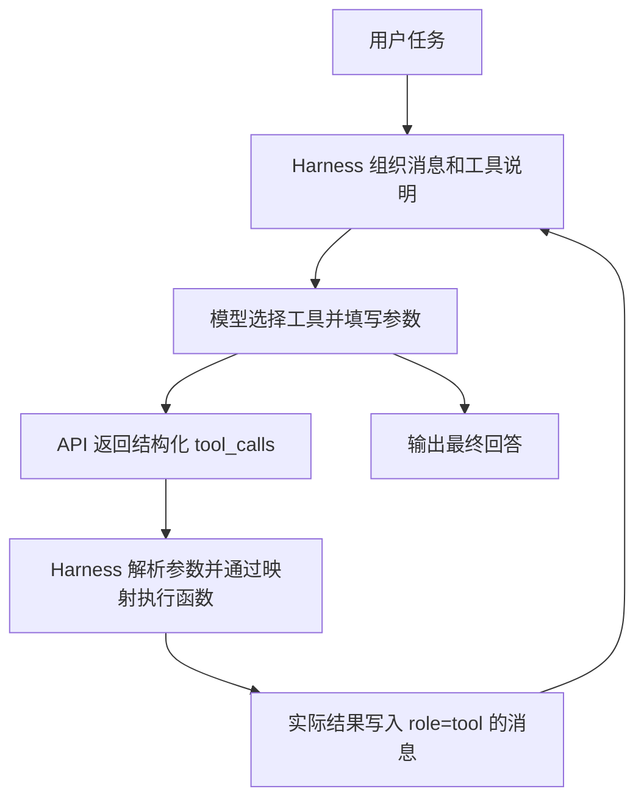
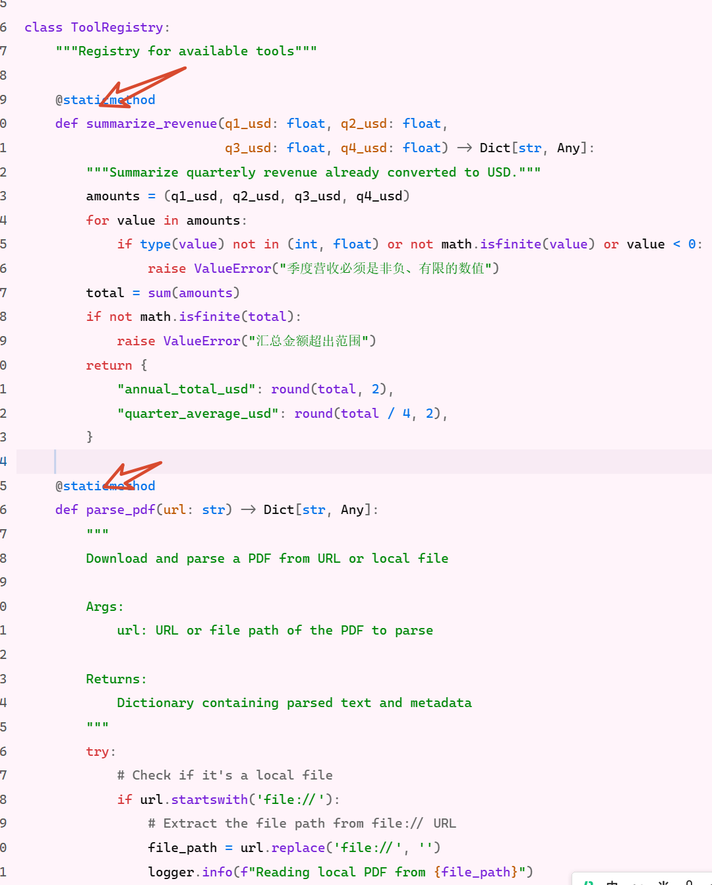

# 2026-10-14：工具注册与上下文学习补充

## 本次完成了什么

在第一章 `chapter1/context` 中接入 `summarize_revenue`，实现美元季度营收的汇总与平均值计算。本地工具说明、函数映射、数值检查与执行结果已验证。未取得新增工具的真实模型调用轨迹，因此不写成完整模型实验完成。

这是在先前第二章 ToolRegistry 离线教学之后的独立改动；本篇以实际接入的第一章 Context 源码为准。

## 函数、工具与模型的区别

- `def` 定义 Python 函数。它可以进行确定性计算、读文件或请求外部服务；有专门用途不等于它是一个小模型。
- AI 模型包含学习得到的参数。函数可以调用模型，但函数自身不因此自动成为模型。
- `@staticmethod` 是类中的静态方法标记，表示调用不需要传入实例参数 `self`。
- 函数的 `"""文档字符串"""` 说明用途、输入和输出，主要供读代码的人使用。当前项目不会自动将它发送给模型。
- 模型可见的说明位于 `_get_tools_description()` 中；函数实现、工具说明和本地执行映射要对应。

## 注册工具的三个位置

### 1. 实现 Python 函数

以下来自本次保存的源码。四个金额必须已经换算为美元，函数不负责获取汇率。

```python
@staticmethod
def summarize_revenue(q1_usd: float, q2_usd: float,
                      q3_usd: float, q4_usd: float) -> Dict[str, Any]:
    """Summarize quarterly revenue already converted to USD."""
    amounts = (q1_usd, q2_usd, q3_usd, q4_usd)
    for value in amounts:
        if type(value) not in (int, float) or not math.isfinite(value) or value < 0:
            raise ValueError("季度营收必须是非负、有限的数值")
    total = sum(amounts)
    if not math.isfinite(total):
        raise ValueError("汇总金额超出范围")
    return {
        "annual_total_usd": round(total, 2),
        "quarter_average_usd": round(total / 4, 2),
    }
```

### 2. 提供模型可见的说明

在 `ContextAwareAgent._get_tools_description()` 返回的工具列表中增加以下条目；其余工具保留：

```python
{
    "type": "function",
    "function": {
        "name": "summarize_revenue",
        "description": "汇总四个已换算为美元的季度营收，计算全年总额和季度平均值。本工具不负责换汇。",
        "parameters": {
            "type": "object",
            "properties": {
                f"q{quarter}_usd": {
                    "type": "number",
                    "minimum": 0,
                    "description": f"第{quarter}季度美元营收",
                }
                for quarter in range(1, 5)
            },
            "required": [f"q{quarter}_usd" for quarter in range(1, 5)],
            "additionalProperties": False,
        },
    },
}
```

`required` 表示选择这个工具时必须提供的参数，不表示每次都必须选择这个工具。Schema 是接口说明，不能替代本地参数校验。

### 3. 建立执行映射

在 `_execute_tool()` 的 `tool_map` 中加入：

```python
"summarize_revenue": self.tools.summarize_revenue,
```

现有代码按名称取出函数，并把参数字典展开成具名参数：

```python
return tool_map[tool_name](**arguments)
```

只有说明没有映射，Harness 无法执行；只有函数没有说明，模型不知道它是一个可调用工具。

## 完整调用流程



模型看见工具名称、说明、参数结构，不会因为注册而收到整个 Python 函数源码。`tool_call_id` 用来把结果与相应调用关联起来。`full` 模式可验证完整回传，`no_tool_calls` 移除工具定义，`no_tool_results` 隐藏工具结果。

## 多个 Python 文件如何接入

不同工具可以分别定义在不同文件中，再导入到 Agent 所在模块。示例（仅说明组织方法，本次实际代码仍在 agent.py）：

```python
from revenue_tools import summarize_revenue

# _execute_tool() 的映射中引用导入的函数
# "summarize_revenue": summarize_revenue
```

模型可见的工具说明仍需要加入 `_get_tools_description()`。注册的对象是可调用函数，不是整个文件；一个业务工具内部也可以调用多个文件中的辅助函数。仅在脚本直接运行时执行的代码应放进 `if __name__ == "__main__":`。

## Prompt、Context、窗口与压缩

- Prompt 是任务指令；在本课程的解释中，它是 Context 的一部分。
- Context 包含本轮提供给模型的指令、任务数据、历史消息、工具说明和工具结果等信息。
- Token 是模型处理内容的计量单位，不固定等于一个汉字或单词。
- Context Window 是模型接口可处理的信息容量；输入和生成预算的限制应按具体接口核对。`max_tokens` 控制生成上限，不能直接当作上下文窗口大小。
- 上下文工程要决定哪些信息进入下一轮、以什么结构和顺序组织，以及如何保留任务状态。
- 最近两轮历史的滑动窗口可能丢掉更早的关键换汇结果；压缩可以保留原始任务、已完成金额和待办步骤，去掉重复过程。
- 压缩实验需要同时检查输入 Token、关键事实保留和最终任务成功，不能只看输出是否变短。

## 验证与当前限制

本地输入：2500000、2282608.70、2278481.01、2541806.02。实际输出总额 **9602895.73**，平均值 **2400723.93**。本地测试通过，真实模型选择新增工具仍待验证。记录见 [验证 JSON](../evidence/tool-registration-local-20261014.json)。

此前五组消融是新增工具之前的记录，包含四个工具。新增营收函数会改变模型可选的工具集，不能把旧结果当成新代码的实测。



## 代码与来源

- [本次 Context 代码说明](../experiments/context/README.md)
- [实际 agent.py](../experiments/context/agent.py)
- [第一章课程项目](https://github.com/bojieli/ai-agent-book/tree/main/chapter1/context)
- [Task1 学习笔记](<03-Task1-上下文工程-学习笔记.md>)
