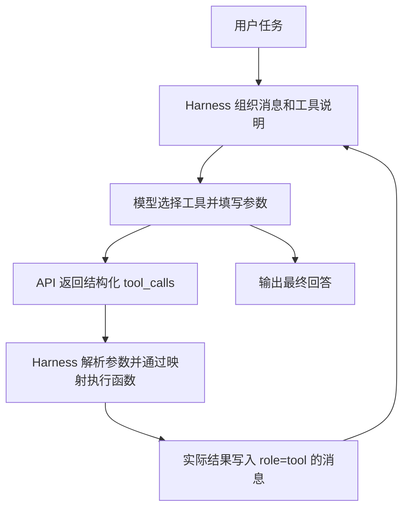

# Python 函数注册为模型可调用工具：Context 项目操作流程


项目：`chapter1/context`。


核心文件：`agent.py`。本篇以实际接入的 `summarize_revenue` 为例，说明第一章 Context 项目的注册方式。前面的第二章离线教学使用了 `register_tool()`；当前项目通过“函数实现 + 工具说明 + 执行映射”接入，不需要照搬那套注册器。


**目标：让模型可以请求一个自己写的 Python 函数，由 Harness 执行，并把真实结果送入下一轮上下文。**


## 先分清函数、工具和模型


- `def` 定义 Python 函数。它可以进行确定性计算、读文件或请求外部服务；有专门用途不等于它是一个小模型。

- AI 模型包含学习得到的参数。函数可以调用模型，但函数自身不因此自动成为模型。

- `@staticmethod` 是类中的静态方法标记，表示调用不需要传入实例参数 `self`。

- 函数的 `"""文档字符串"""` 说明用途、输入和输出，主要供读代码的人使用。当前项目不会自动将它发送给模型。

- 模型可见的说明位于 `_get_tools_description()` 中；函数实现、工具说明和本地执行映射要对应。


## 注册工具的三个位置


### 1. 实现 Python 函数


以下来自本次保存的源码。四个金额必须已经换算为美元，函数不负责获取汇率。


```python

@staticmethod

def summarize_revenue(q1_usd: float, q2_usd: float,

                      q3_usd: float, q4_usd: float) -> Dict[str, Any]:

    """Summarize quarterly revenue already converted to USD."""

    amounts = (q1_usd, q2_usd, q3_usd, q4_usd)

    for value in amounts:

        if type(value) not in (int, float) or not math.isfinite(value) or value < 0:

            raise ValueError("季度营收必须是非负、有限的数值")

    total = sum(amounts)

    if not math.isfinite(total):

        raise ValueError("汇总金额超出范围")

    return {

        "annual_total_usd": round(total, 2),

        "quarter_average_usd": round(total / 4, 2),

    }

```


### 2. 提供模型可见的说明


在 `ContextAwareAgent._get_tools_description()` 返回的工具列表中增加以下条目；其余工具保留：


```python

{

    "type": "function",

    "function": {

        "name": "summarize_revenue",

        "description": "汇总四个已换算为美元的季度营收，计算全年总额和季度平均值。本工具不负责换汇。",

        "parameters": {

            "type": "object",

            "properties": {

                f"q{quarter}_usd": {

                    "type": "number",

                    "minimum": 0,

                    "description": f"第{quarter}季度美元营收",

                }

                for quarter in range(1, 5)

            },

            "required": [f"q{quarter}_usd" for quarter in range(1, 5)],

            "additionalProperties": False,

        },

    },

}

```


`required` 表示选择这个工具时必须提供的参数，不表示每次都必须选择这个工具。Schema 是接口说明，不能替代本地参数校验。


### 3. 建立执行映射


在 `_execute_tool()` 的 `tool_map` 中加入：


```python

"summarize_revenue": self.tools.summarize_revenue,

```


现有代码按名称取出函数，并把参数字典展开成具名参数：


```python

return tool_map[tool_name](**arguments)

```


只有说明没有映射，Harness 无法执行；只有函数没有说明，模型不知道它是一个可调用工具。


## 完整调用流程





模型看见工具名称、说明、参数结构，不会因为注册而收到整个 Python 函数源码。`tool_call_id` 用来把结果与相应调用关联起来。`full` 模式可验证完整回传，`no_tool_calls` 移除工具定义，`no_tool_results` 隐藏工具结果。


## 多个 Python 文件如何接入


不同工具可以分别定义在不同文件中，再导入到 Agent 所在模块。示例（仅说明组织方法，本次实际代码仍在 agent.py）：


```python

from revenue_tools import summarize_revenue


# _execute_tool() 的映射中引用导入的函数

# "summarize_revenue": summarize_revenue

```


模型可见的工具说明仍需要加入 `_get_tools_description()`。注册的对象是可调用函数，不是整个文件；一个业务工具内部也可以调用多个文件中的辅助函数。仅在脚本直接运行时执行的代码应放进 `if __name__ == "__main__":`。


## 模型调用与结果回传的关键代码


下面是项目正常工具调用路径的教学简化。它依赖已有的 Agent、消息列表和请求参数；省略了错误处理与实验轨迹记录，不能作为独立脚本直接运行。


```python

# 把工具说明随任务、历史消息一起发给模型

create_kwargs["tools"] = self._get_tools_description()

create_kwargs["tool_choice"] = "auto"

response = self.client.chat.completions.create(**create_kwargs)

message = response.choices[0].message


if message.tool_calls:

    # 先保存模型的调用请求，再添加与其对应的工具结果

    messages.append(self._prepare_assistant_message(message))

    for tool_call in message.tool_calls:

        tool_name = tool_call.function.name

        arguments = json.loads(tool_call.function.arguments)

        result = self._execute_tool(tool_name, arguments)

        messages.append({

            "role": "tool",

            "tool_call_id": tool_call.id,

            "content": json.dumps(result, ensure_ascii=False),

        })

    # 外层循环会把更新后的消息发送给模型，继续决策。

```


- `tool_choice="auto"`：让模型根据任务决定是否调用工具。

- `tool_call.function.name`：模型请求的工具名称。

- `tool_call.function.arguments`：API 返回的参数 JSON 字符串，需要解析并校验。

- `**arguments`：把参数字典展开成 Python 函数的具名参数。

- `role="tool"`：将执行结果作为工具消息回传。

- `tool_call_id`：让结果与对应的工具调用关联。


例如，工具参数可以是：


```json

{

  "q1_usd": 2500000,

  "q2_usd": 2282608.70,

  "q3_usd": 2278481.01,

  "q4_usd": 2541806.02

}

```


这段是参数示例，不是新增工具已被模型调用的证据。本地执行上述参数已得到：


```json

{

  "annual_total_usd": 9602895.73,

  "quarter_average_usd": 2400723.93

}

```


## 函数里的描述必须写吗


函数里的三引号文档字符串说明用途、参数和返回值，主要给开发者阅读；删除它不影响函数执行。当前项目不会自动读取它生成模型工具说明。


模型看到的是 `_get_tools_description()` 中的 `name`、`description` 和 `parameters`。应写清工具适用场景、参数含义与单位。两份说明分别维护，不能只写了函数文档就认为已经完成工具注册。


## 验证时看什么


1. 检查 `_get_tools_description()` 是否包含新工具。

2. 使用已知参数直接执行 `_execute_tool()`，核对计算结果。

3. 检查缺失参数、错误类型和非法金额；Schema 不能代替本地校验。

4. 使用 `full` 模式调用真实模型，查看 `tool_calls` 中是否实际出现 `summarize_revenue`，参数是否正确。

5. 对照工具返回值和最终回答，确认结果被模型利用。


本次已核验：函数、说明和映射已接入；3 个本地测试通过，覆盖注册与执行、非法金额、数值溢出。新增工具的真实模型调用尚未有已核验的轨迹，不能只凭最终金额正确认定工具调用成功。


五组消融实验发生在新增工具之前：旧证据包含四种工具，当前代码包含五种工具，后续复现实验需要记录工具集变化。


## 一句话记忆


**开发者写函数和工具说明 → Harness 把任务与说明发送给模型 → 模型选择工具并填写参数 → Harness 执行函数 → 把结果送回模型 → 模型继续决策或回答。**
