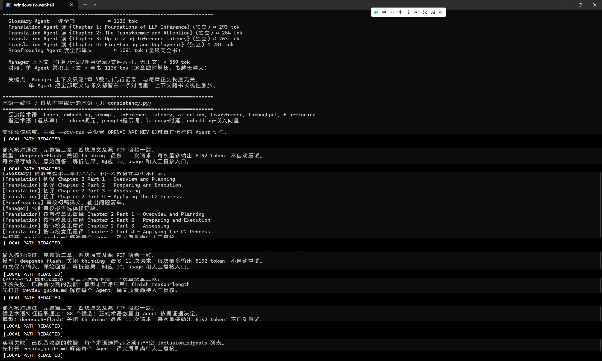

# 第十章：多 Agent 协作 实验记录

理论：[10-第十章-多Agent协作-理论笔记](<10-第十章-多Agent协作-理论笔记.md>)

## 当前状态

2026-10-29 补充：[逐 Agent 质量评估](<10-第十章-多Agent翻译实验-质量评估.md>)。新增历史运行数据复算、问题前后对照和指标定义；下方保留当时的主观初检记录，不将其作为统一量表的正式测量。

2026-10-26：已完成“实验 10-2：多 Agent 长文翻译”的真实模型运行，并开始逐个检查 Agent 的输出质量。

> [!important] 当前结论
> 工作流已经跑通，但译文质量尚未通过人工验收。程序记录的状态也是 `workflow_status=completed`、`quality_status=pending_human_review`。因此只能说“11 次模型调用及文件流转完整完成”，不能说“翻译质量合格”。

## 实验 10-2：多 Agent 长文翻译

### 1. 为什么做这个实验

这次实验不是为了机械地运行教材 Demo，而是要回答以下问题：

1. 同一个大模型怎样通过不同提示词承担 Glossary、Translation、Proofreading 和 Manager 角色？
2. Agent 与 Python 函数分别负责什么？
3. 各 Agent 之间实际传递了哪些数据，数据保存在内存还是文件中？
4. 为什么正文变长会显著增加 Translation Agent 的上下文，却不一定同比增加 Manager Agent 的上下文？
5. 怎样查看每个 Agent 的原始输入、原始回答和解析结果，并人工判断质量？

### 2. 实验材料与范围

- 原始材料：本地“现行官方条令”资料目录中的第一个 PDF，《Command and Control》。笔记不记录个人目录名和本机绝对路径。
- 翻译范围：完整第二章 `The Command and Control Process`。
- 切分方式：按内容结构切成 4 块，而不是把整章一次塞给一个 Translation Agent。
- 翻译方向：英文 → 中文。
- 模型：`deepseek-flash`。
- 运行约束：最多 11 次模型请求；单次最多输出 8192 token；关闭 thinking；不自动重试。

这里的 11 次不是“模型只能调用 11 次”的普遍规律，而是本次工作流按预期节点计算出的请求预算：1 次术语提取 + 4 次初译 + 1 次审校 + 1 次 Manager 决策 + 最多 4 次修订。限制的目的，是防止程序异常循环或费用失控；8192 token 则是单次响应的输出上限，不代表输入上下文只有 8192 token。

### 3. 项目架构：Agent、Python 函数和文件分别干什么

这套实验中的 4 种 Agent 不是 4 个独立进程，也不是 4 个不同模型。它们是同一个模型在不同调用中，接收不同的角色提示词、输入数据和输出约束后形成的逻辑角色。

| 组成 | 主要职责 |
|---|---|
| Python 编排代码 | 读取和切分原文、生成术语候选、拼接 system/user 消息、调用模型、校验返回结构、保存证据、决定下一步调用谁 |
| Agent 角色 | 根据本次调用拿到的提示词和材料完成术语筛选、翻译、审校或调度判断 |
| 文件系统 | 保存每次请求、原始回答、解析结果、术语库、初稿、审校报告、Manager 决策、修订稿和最终合并译文 |

各角色的数据边界如下：

| Agent | 实际读取的核心数据 | 输出 |
|---|---|---|
| Glossary Agent | 第二章全文 + Python 生成的 88 个候选术语及证据 | 正式术语、排除项及理由 |
| Translation Agent（初译） | 当前一块英文原文 + 全书术语表 + 翻译规则 | 当前块中文初稿 |
| Proofreading Agent | 4 块中文初稿 + 术语表；**没有英文原文** | 初稿问题清单 |
| Manager Agent | 任务信息、文件索引、审校报告；不持有整章正文 | 需要修订的块及修订要求 |
| Translation Agent（修订） | 当前块英文原文 + 术语表 + 对应审校意见 | 重新生成的修订稿 |

因此，本实验里的数据传递同时用了两种方式：

- 同一次 Python 运行内部，程序先把术语表、译文等保存成 Python 对象，再作为参数传给下一个函数；
- 同时把每一步产物落盘，供人工检查和最终组装。

它没有实现“4 个独立进程各自监听共享文件夹”。文件在这里主要承担持久化证据、人工复核和结果组装，Python 内存对象承担当前运行中的直接传参。

### 4. 上下文为什么不会一起按正文长度增长

我的判断是：正文增加 10 倍时，Translation Agent 因为必须读取并翻译正文，其输入上下文会随正文显著增长；Manager Agent 不读取正文，只读取章节结构、文件索引、任务规则和审校摘要，因此它的上下文不会随正文字数同比增长。

这个判断在**当前架构下成立**。但 Manager 的上下文也不是固定不变：章节数、调用记录和审校问题越多，它读到的元数据和报告也会增加。准确说法是：Manager 的上下文主要随“任务结构和报告规模”增长，而不是随“正文总字数”线性增长。

### 5. 实际运行过程

#### 5.1 离线预演

先运行 `--dry-run`，只检查输入切分、调用计划、上下文预算和文件结构，不调用真实模型。因此当时看到“真实模型调用为 0”是正常现象，不是程序漏调模型。

#### 5.2 第一次真实运行：工作流跑通，但术语只有 10 个

- 运行目录：`run-20261026T144816236335Z`
- 结果：11 次调用完成。
- 问题：旧提示词把术语数限制为 10 个，只能证明编排链路能跑，不能证明术语库覆盖充分。

这一步暴露出一个重要问题：术语库不能简单用固定数量定义，应该依据“是否具有领域术语特征”决定是否收录。

#### 5.3 第二次运行：直接取消数量上限，输出被截断

- 运行目录：`run-20261026T150105719530Z`
- 结果：第 1 次 Glossary 调用失败。
- 直接错误：`finish_reason=length`。
- 原因：把整章交给模型后要求“不限数量地提取全部术语”，输出范围失去边界，模型在 8192 token 内没有正常结束。

结论：“不设置术语数量上限”不等于“所有词都算术语”，更不等于“让模型无限枚举”。应先根据可解释特征生成候选，再由 Agent 判断候选是否具有术语性。

#### 5.4 第三次运行：先生成 88 个候选，但输出协议冲突

- 运行目录：`run-20261026T152056342627Z`
- Python 先依据跨章节出现、重复频次、章节标题、定义句、缩写、命名框架、对照概念等特征生成 88 个候选。
- Glossary Agent 再进行语义筛选。
- 结果：仍在第 1 次调用后失败。
- 直接错误：`每个术语选择都必须有非空 inclusion_signals 列表。`

根因不是模型“不会提术语”，而是提示词与校验器对“排除候选”的表达没有对齐：模型用空 `inclusion_signals` 表示不收录，程序却把返回列表中的每一项都当成正式术语，并强制要求非空收录依据。模型表达了排除意图，但数据协议没有给排除项正式位置。

#### 5.5 根因修复

修复后的输出契约把两类结果分开：

- `glossary`：正式收录的术语，必须带非空收录依据；
- `excluded`：明确排除的候选，必须带排除理由。

同时增加三项结构校验：

1. 88 个候选中的每一个都必须有且只有一个决定；
2. 同一候选不能同时出现在收录和排除列表；
3. 不能返回候选集以外的编号。

本次修复没有加静默兜底，也没有把异常吞掉，而是把真正的数据契约补完整。针对性验证结果为：25 个测试通过、Python 编译检查通过、离线预演为 0 次真实模型调用；历史失败响应按新协议转换后也能验证为 84 个收录、4 个排除、共 88 个决定。

#### 5.6 第四次运行：完整跑通

- 运行目录：`run-20261026T153700605628Z`
- 工作流状态：`completed`。
- 语义质量状态：`pending_human_review`。
- 真实模型调用：11 次。
- 术语候选：88 个；正式收录 81 个；排除 7 个。
- 后续调用：4 次初译、1 次审校、1 次 Manager 决策、4 次修订。
- 自动重试：0 次。
- 每次调用的请求、原始回答、解析结果、响应 ID 和 token 用量均单独保存。

上图保留了本实验的关键运行轨迹：早期完整运行、取消术语上限后的长度失败、候选筛选协议失败，以及修复后再次运行的开头。为保护隐私，截图中的个人用户名和本机绝对路径已遮挡，Agent 输出、调用次数和错误信息未改动。截图只能证明终端当时显示了这些状态；最终是否完整完成，以最后一次运行目录中的 `run_manifest.json` 和 11 份调用证据为准。

### 6. 最终产物应该怎么看

先打开本次运行目录中的 `review_guide.md`，再按角色查看：

1. `agents/001_glossary_extraction/`：Glossary Agent 的请求、原始回答和结构化结果；
2. `agents/002`～`005_translation_draft_*`：4 块初译；
3. `agents/006_proofreading_initial_review/`：审校输入和问题清单；
4. `agents/007_manager_decision/`：Manager 的判断依据和决定；
5. `agents/008`～`011_translation_revision_*`：4 块修订；
6. `bilingual/`：逐块英中对照，最适合人工判断漏译和误译；
7. `chapter2_zh.md`：最终合并译文；
8. `agent_calls.json`：11 次调用的统一索引和 token 用量。

不要只看终端中的“完成”。终端是进度摘要，真正用于质量判断的是每个 Agent 保存下来的输入、原始输出、解析结果和英中对照。

### 7. 各 Agent 质量人工初检

以下分数是本次人工初检的主观量表，不是程序自动评分，也不是最终验收结论。

| 调用 | 初检分数 | 主要判断 |
|---|---:|---|
| Glossary Agent | 4/10 | 覆盖率比 10 词版本高，但过度收录普通短语，存在同义重复、核心术语漏收和错误译法 |
| Translation 初译 01 | 6.5/10 | 基本完整可读，但受术语库错误影响，个别条令表达生硬 |
| Translation 初译 02 | 5/10 | 出现跨页断句误拼，`Airmen`、`MTO` 等翻译需核对 |
| Translation 初译 03 | 7/10 | 整体较稳，MOP/MOE 区分较清楚，但有“评做”等文字错误 |
| Translation 初译 04 | 5/10 | 残留英文，部分条令术语和专名处理不稳定 |
| Proofreading Agent | 5.5/10 | 能发现残留英文、错字和跨页问题，但没有英文原文，无法可靠判断漏译、误译和术语本义 |
| Manager Agent | 6/10 | 能按报告选择 4 块修订，但没有独立核查正文；提出“补充术语表”时，后续工作流也没有真正执行该动作 |
| Translation 修订 01 | 7/10 | 修复部分表达和缩写问题，但仍受术语库约束 |
| Translation 修订 02 | 5.5/10 | 试图修复跨页句，但重组结果仍不正确，并残留 `[待审]` |
| Translation 修订 03 | 5.5/10 | 修复了原错字，却新引入 `accompanying 计划` 的中英混排 |
| Translation 修订 04 | 7/10 | 清理了多数残留英文并补充部分缩写，但脚注 9 仍缺失，部分标题和术语仍需核对 |

#### 术语库的具体问题

- 同义重复：`Assessment/Assessing`、`Coordination/Coordinating`、`TAC C2/Tactical C2` 分成多条，没有做概念归一。
- 疑似普通短语被收录：`below the theater`、`applying heading`、`assessment considerations` 等。
- 可疑译法：`refining → 精炼`、`Transitioning → 转换`、`CC-DC-DE → 集中控制-分散控制-分散执行框架`。其中 CC 在原条令语境中需要重点核对是否应为“集中指挥”。
- 核心项漏收：`DIRLAUTH`、`OPCON`、`CCMD`、`JFC`、`Operational Environment/OE`、`MTO` 未进入正式术语表。

因此新版术语库从旧版的“覆盖不足”走到了“召回高但精度低”。数量增加不是质量提高，后续必须加入概念归一和领域人工审核。

#### 翻译与修订的典型问题

- 第二块原文 `Nodes may span several levels of operations and have varying levels of capability.` 被页面中的插入框打断，初译和修订都没有正确重组句子。
- 第三块初译中的错字被修复，但修订又引入新的中英混排，说明“重新翻译整块”可能修复旧错，也可能制造新错。
- 第四块修订清理了部分英文残留，但原文脚注 9 的正文没有进入最终译文。

这说明当前修订不是在旧稿上做精确修改，而是结合原文和反馈重新生成整块译文。没有第二轮审校时，修订稿的新增错误无法被系统自己发现。

#### 审校和 Manager 的能力边界

Proofreading Agent 只拿到中文初稿和术语表，没有拿到英文原文。因此它可以检查流畅性、格式和术语表面一致性，却无法可靠完成忠实度审校。它虽然发现了跨页断句，但给出的重组建议仍不正确，也漏掉了 `MTO`、脚注 9 和部分术语本义问题。

Manager Agent 读取的是审校报告和文件索引，不是完整正文。它把报告中命中的 4 块全部送回修订，路由动作是正确的；但它不能独立判断报告是否误报、漏报。更关键的是，它要求“补充术语表”，而现有流程没有安排 Glossary Agent 二次修订术语表，这条要求实际上没有执行闭环。

### 8. 本次问答结论

#### 为什么最开始真实模型调用为 0？

因为执行的是 `--dry-run`。它只做离线预演，用于验证输入、路径、切分和调用计划，不应产生真实 API 调用。

#### 术语库应该怎么定义？

不能用“固定 10 个”，也不能把所有词都当术语。比较合理的两阶段办法是：Python 根据频次、跨章节分布、标题、定义句、缩写、命名框架等可解释特征生成候选；Glossary Agent 再结合语义判断是否属于需要统一译法的领域概念。是否收录应有证据，但频次只是信号之一，不是唯一标准。

#### 为什么要限制请求次数和单次 token？

它们是运行预算和故障保护，不是为了减少术语。请求次数用于阻止异常循环和意外费用；单次输出上限用于防止无限生成。真正的问题不是“有限制”，而是任务切分和输出契约必须能在预算内正常完成。

#### 怎样检查一个 Agent 的质量？

不能只看最终合并译文。要依次检查该 Agent 的 system/user 输入、它实际获得的数据、原始回答、解析后的结构、下游是否正确使用，以及与英文原文的对照。一次调用格式正确，只能证明结构可用，不能证明语义正确。

### 9. 实验最终结论

1. 这套项目已经证明多角色编排、证据保存和文件流转可以完成。
2. “Agent”不只是一个名字，也不只是提示词。更准确地说，它由角色提示词、可见数据、可用工具、输出协议、状态和运行边界共同定义。
3. 当前 4 种 Agent 是同一模型的不同逻辑角色，不是 4 个独立模型或 4 个独立进程。
4. 工作流跑通不等于翻译质量合格；格式校验、语义审校和人工验收是三件不同的事。
5. 术语库越大不一定越好。候选生成、语义筛选、概念归一和领域审核缺一不可。
6. 审校 Agent 如果看不到英文原文，只能做中文侧检查，不能承担完整忠实度审校。
7. 修订后必须再次审校，否则可能出现“修掉一个问题，又新造一个问题”。
8. Manager 的提示词中写了某项要求，不代表系统就能执行；还必须有对应的数据、工具和后续节点。

### 10. 下一版改进方向（尚未实现）

1. 增加术语概念归一阶段，合并大小写、词形变化、全称和缩写。
2. 对关键军事条令术语增加人工审核入口，而不是让模型直接定稿。
3. 让 Proofreading Agent 同时读取英文原文和中文译文，区分语言润色与忠实度审校。
4. 把整块重译改为针对问题位置的定点修订，减少无关段落回归。
5. 修订后再运行一次独立审校，并设置最终验收门禁。
6. 为 Manager 提供真正可调用的“退回术语库修订”节点，让决策可以执行闭环。

## 待做：角色切换与 Skill 加载对比

### 要验证什么

在同一个模型和任务条件下，观察切换系统提示词、工具集，与加载 Skill 两条路径，分别怎样影响当前角色、共享历史和工具调用。

### 实际操作与结果

待实际运行后记录。重点保留角色切换或 Skill 加载动作、当时可用工具、关键输入输出及任务是否完成；不能把作者示例当作自己的运行结果。

## 待观察：通过共享文件交换资料

观察一个 Agent 写入文件后，另一个 Agent 怎样获知路径、读取内容并继续工作，以区分共享存储与共享模型上下文。

当前翻译实验在同一 Python 进程内通过对象传参，并同步把产物落盘；它还不是“多个独立 Agent 进程只靠共享文件协作”的实验。后续若验证该模式，需要把每个角色拆成独立执行单元，并记录文件写入、通知、读取和冲突控制过程。
