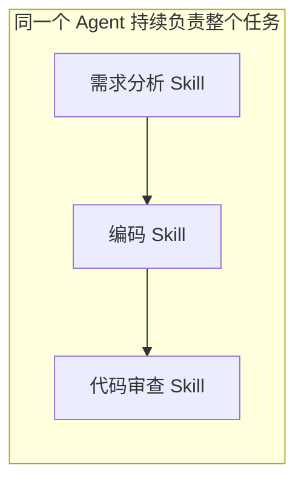

# 第十章：多 Agent 协作 理论笔记

原文：[多 Agent 协作](https://github.com/bojieli/ai-agent-book/blob/main/book/chapter10.md)  
实验：[10-第十章-多Agent协作-实验记录](<10-第十章-多Agent协作-实验记录.md>)

记录日期：2026-10-26。本文整理本次学习中的问题、答案和解释示例；理论部分尚未学完整章，但已完成实验 10-2 的真实模型运行和首轮质量检查，详见实验记录。

## 本章解决什么问题

多个 Agent 怎样分工、传递信息和交接任务，以及什么时候需要多个 Agent。

本次先理解两件事：

1. 角色变化与 Agent 数量的关系：提示词、Skill、工具配置和程序调度分别起什么作用。
2. 协作资料怎样保存和交换：专属工作区、共享空间、外部资源和系统资源怎样划分。

课程中的 Task 5 对应原文第十章，任务编号与章节编号不同。

## 我的问题与答案

### 只是通过提示词和 Skill，就能实现 Agent 角色转换吗？怎样判断一个还是多个 Agent？

**我的问题（按原意整理）：** 提示词和 Skill 改了，角色就变了吗？不同 Agent 是不是靠不同提示词和 Skill 来定义的？如果同一个模型不断换角色，为什么能叫多个 Agent？

**答案：可以用提示词或 Skill 改变角色行为，但角色变化本身不足以证明新增了一个 Agent。**

先区分几个概念：

| 概念 | 作用 | 例子 |
|---|---|---|
| 模型 | 提供理解、推理和生成能力 | 多个 Agent 可以调用同一个模型 |
| 提示词 | 说明任务、职责、约束和表达方式 | “负责审查代码，列出问题和依据” |
| Skill | 提供可复用的操作规程，也可以附带脚本、模板和资料 | 按检查清单审查代码 |
| 工具 | 提供实际读取、查询、写入和执行的接口 | 读文件、运行测试 |
| Agent 的组织与运行 | 程序决定由谁承担任务、使用哪些配置、何时执行和交接 | 分析角色完成后交给编码角色 |

下面两种做法都可以完成“分析需求 → 写代码 → 审查代码”，但组织方式不同。

**做法一：一个 Agent，按需加载不同 Skill。**



就像一个人先看需求说明，再看开发手册，最后拿检查清单自查。使用三份规程，不等于出现了三个独立执行者。

**做法二：定义多个逻辑 Agent，明确交接任务。**


程序分别定义角色的职责、指令、工具和交接规则，再决定当前由谁接管任务。这三个逻辑 Agent 可以使用同一个模型，也可以串行执行。

本章“共享上下文的多 Agent”采用后一种逻辑角色划分：切换当前角色的系统提示词和工具配置，前面的历史继续保留。这里的“独立”主要指角色职责和配置独立，不要求各有独立模型、进程或聊天记录。

实际判断时可以看下面几个例子：

| 实际情况 | 更准确的描述 |
|---|---|
| 一个助手加载分析、编码、审查三个 Skill | 一个 Agent，具有多项技能 |
| 只在聊天里说“现在扮演审查员” | 发生角色变化，单凭这句话无法认定多个 Agent |
| 程序定义多个角色，并实际进行任务移交 | 多个逻辑 Agent，符合本章共享上下文部分的用法 |
| 两个调研 Agent 使用相同提示词，分别调查不同城市并汇总 | 仍然可以是两个 Agent；提示词不同不是必要条件 |

**我的理解：提示词和 Skill 的数量不能直接用来数 Agent。需要看程序怎样划分任务承担者、调度执行和交接控制权。**

“单 Agent 多角色”和“多个逻辑 Agent”存在命名边界。共享历史的顺序角色切换，本书放在多 Agent 中讨论；不共享上下文的架构则让每个 Agent 各有自己的上下文、轨迹和状态，通过文件或消息显式协作。描述实际系统时，要把这些运行方式说清楚。

还有一个权限边界：在提示词或 Skill 中写“审查员禁止修改文件”，只是行为要求。要强制禁止修改，需要 Harness，也就是程序运行层，限制工具调用和实际执行权限。

### 图中的存储，是不是传统编程时代已有的数据存储方式？

**我的问题：** “我理解这是不是以前 coding 时代数据存储手段的一种方式？”

**答案：基本是。这里把传统软件工程中的文件系统抽象、目录挂载、权限隔离和协作读写，用到 Agent 系统中。这些现在也仍然是常用基础设施。**

这张图重点讲的是：把不同来源的数据，组织为统一的目录和文件访问接口。

```text
传统程序 → 调用文件接口 → 读取数据
Agent → 提出工具调用 → 程序执行文件接口 → 结果回到上下文
```

例如，三个 Agent 通过共享文件交换成果：

```text
Agent A 查资料 → 写入共享目录“资料.md”
Agent B 读取“资料.md” → 写入“分析.md”
Agent C 读取这两份文件 → 生成“报告.md”
```

这个过程与传统程序通过共享目录交换数据相通。Agent 系统还需要明确谁可以读写、文件保存多久，以及多人同时写入时怎样避免覆盖。

### 底层可以是数据库、文件夹或者资源管理器吗？这些区域怎样划分？

**我的问题（按原意整理）：** 这种存储不一定只有数据库，也可能是文件夹或者资源管理器；图中的几个区域是不是在划分这些存储？

**答案：底层可以采用文件夹、数据库、对象存储、网盘或其他外部资源；这张图不要求一定有数据库。资源管理器则是查看和操作文件的界面，本身不是存储方式。**

如果要把数据库内容纳入统一文件接口，需要由适配器把查询结果映射成可访问的资源；也可以单独提供数据库查询工具，并非所有数据都必须包装成文件。

图中的四个区域主要按用途、可见性、生命周期和读写权限划分：

| 区域 | 用来做什么 | 可见性与保存方式 |
|---|---|---|
| Agent 专属工作区 | 保存草稿、临时文件、中间结果 | 按图中的设计，仅该 Agent 可见，随实例结束清理 |
| 多 Agent 共享空间 | 交换资料、保存交付物，供用户上传和下载 | 协作 Agent 和用户可见，按任务需要持久化；多人写入需处理冲突 |
| 外部挂载资源 | 接入网盘、知识库等外部数据 | 受源系统授权约束，生命周期由外部来源决定 |
| 系统内置资源 | 提供 Skill、模板、手册等公共资料 | 按图中的设计只读共享，跨会话稳定 |

**这些是逻辑访问区域，不要求一个区域对应一个数据库、一块硬盘或一台机器。**

最简单的实现，可以是同一块硬盘上的几个目录，再由程序落实权限与生命周期管理；复杂一些，也可以分别连接不同存储系统。只有目录名称不同，并不会自动产生权限隔离。

例如 `/workspace/shared` 看起来是目录，背后可以是真实文件夹，也可以是映射出来的云端资源。统一的是访问入口，底层存储可以不同。

### 补充理解：共享文件，是否等于共享模型上下文？

**不等于。** 文件保存了数据，不代表另一个 Agent 的模型已经读取或知道内容。

```text
A 写入“资料.md”
→ B 获得文件路径或发现该文件
→ B 调用读取工具
→ 程序把读取结果放入 B 的上下文
→ B 的模型据此继续工作
```

因此，两个 Agent 可以各有独立上下文，同时读写同一个共享目录。文件是交换资料的媒介；文件内容是否进入上下文，还取决于实际读取与消息组织。

## 后续实操要观察什么

- 对比系统提示词切换与 Skill 加载时，提示词、工具列表和历史记录分别怎样变化。
- 检查角色交接是否真的发生，不能只看最终回答声称“由某角色完成”。
- 观察共享文件被写入后，另一个 Agent 在什么时候读取，以及读取结果怎样进入它的上下文。

实验 10-2 已验证多角色翻译编排、对象传参、产物落盘和逐 Agent 证据保存，但它没有验证“角色切换与 Skill 加载对比”，也没有把各角色拆成只依赖共享文件协作的独立进程。上述两项仍是后续验证方向，不能用本次翻译实验替代。
